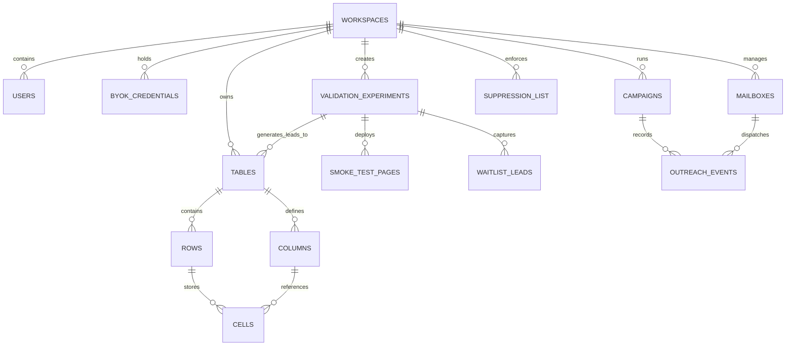

# Product Requirements Document (PRD) — LeadLoom Core

**Product Name:** **LeadLoom** *(The Signal-to-Revenue Engine)*  
**Document Version:** 2.1 (Idea Validator & 3D WebGL Upgrade)  
**Author:** Principal Staff Engineer & Product Architect  
**Target Release:** v0.1 (Proprietary product; hosted by us)  
**Primary Repository:** private repository (not public)  
**License:** Proprietary. All rights reserved. LeadLoom is not an open-source project (Kamal, 2026-11-10). Third-party dependencies keep their own licenses; do not remove their notices.  

---

## 1. Executive Summary & Product Vision `[Recommended Skill: prd-generator]`

### 1.1 The Market Opportunity
Modern outbound Go-To-Market (GTM) engines like the leading hosted GTM platforms suffer from three fundamental architectural and economic flaws:
1. **Predatory Markups on Wholesale Data:** SaaS vendors charge 300% to 1,000% markups on third-party enrichment APIs (e.g., reselling a $0.003 Hunter/Apollo call for $0.03 to $0.05 in proprietary "credits").
2. **Brittle Vendor Lock-in:** Proprietary table schemas trap contact records, prompt engineering templates, and custom scraping logic inside closed databases.
3. **Execution-Enrichment Fragmentation:** Teams enrich leads in tool A, draft copy with LLM B, sequence emails via tool C, and handle replies in tool D, causing lead leakage, broken webhooks, and deliverability blind spots.
4. **The "Pre-Product" Premature Build Trap:** Founders and product teams spend months building SaaS software nobody wants because validating market demand and capturing buyer waitlists requires assembling 5 separate landing page, scraping, and sequencing tools.

### 1.2 The LeadLoom Vision
**LeadLoom** is a proprietary, unified GTM orchestration engine that merges **multi-signal intent detection**, **bring-your-own-key (BYOK) adaptive enrichment cascades**, **pre-product idea validation (smoke-testing)**, and **native multi-channel outbound sequencing** into a single self-hostable workspace. It allows growth teams, developers, and founders to run enterprise-grade data enrichment and market validation at pure wholesale API cost while maintaining complete sovereignty over their data.

```
┌─────────────────────────────────────────────────────────────────────────────────┐
│                          LEADLOOM UNIFIED ARCHITECTURE                          │
├─────────────────────────────────────────────────────────────────────────────────┤
│                                                                                 │
│   ┌─────────────────────────────────────────────────────────────────────────┐   │
│   │                        Next.js 14 App Canvas                            │   │
│   │   Virtualized Grid (50k+ Rows)  │  Split Sequencer  │  DAG Flow Builder │   │
│   │   Idea Validator (/v/[slug])    │  Scorecard Radar  │  Living 3D Core   │   │
│   └────────────────────────────────────┬────────────────────────────────────┘   │
│                                        │ tRPC / WebSockets                      │
│   ┌────────────────────────────────────▼────────────────────────────────────┐   │
│   │                        NestJS Core Engine                               │   │
│   │    • Vault AES-256-GCM  • FinOps Cache (30d TTL)  • Token Bucket Rate   │   │
│   │    • DAG Resolver       • Mailbox Health Monitor  • OAuth2 Token Loop   │   │
│   │    • Hypothesis Engine  • Scorecard Telemetry     • Redis Edge Buffer   │   │
│   └───────────────────┬────────────────────────────────┬────────────────────┘   │
│                       │                                │                        │
│   ┌───────────────────▼────────────────┐   ┌───────────▼────────────────────┐   │
│   │   Persistence & Storage            │   │   BullMQ Worker Clusters       │   │
│   │   • PostgreSQL 16 + pgvector       │   │   • Scraper Worker (Playwright)│   │
│   │   • Redis 7 (Queues + Token State) │   │   • Waterfall DAG Worker (BYOK)│   │
│   │   • Dynamic JSONB Cell Store       │   │   • SMTP Sequencer Worker      │   │
│   │   • Validation & Waitlist Tables   │   │   • Smoke-Test Ingestion Worker│   │
│   └────────────────────────────────────┘   └────────────────────────────────┘   │
└─────────────────────────────────────────────────────────────────────────────────┘
```

---

## 2. Product Positioning & Value Propositions `[Recommended Skill: landing-page-design]`

* **Tagline:** *Zero-markup, signal-driven outbound engine with instant idea validation.*
* **Positioning:** A bring-your-own-key GTM platform and manual pre-product smoke-testing.
* **Core Value Pillars:**
  1. **Zero Data Markup (BYOK):** Plug in your raw Apollo, Hunter, Anymail Finder, Dropcontact, Perplexity, or OpenAI keys. Pay providers directly; LeadLoom takes zero commission on API calls.
  2. **Adaptive DAG Waterfalls:** Short-circuit expensive enrichment tiers as soon as a low-cost tier returns a verified, deliverable email.
  3. **Idea Validation & Smoke-Testing Engine:** Test startup or feature hypotheses in 30 minutes with an auto-generated micro-waitlist site and targeted founder research outbound sequence.
  4. **High-Density Data Grid:** Virtualized 50,000+ row canvas operating at a continuous 60fps with cell-level micro-telemetry.
  5. **Native Infrastructure FinOps:** Built to run on a single $4–$6/month VPS (2 vCPU, 4GB RAM) with domain-level caching and co-located `pgvector`.

---

## 3. Data Model & Entity-Relationship Specification (ERD) `[Recommended Skill: backend-patterns]`

The database schema is managed via **Prisma ORM** running on **PostgreSQL 16** with the `pgvector` extension enabled.



### 3.1 Relational & Dynamic Table Definitions

#### `workspaces` Table
Primary multi-tenant isolation boundary.
```sql
CREATE TABLE workspaces (
    id UUID PRIMARY KEY DEFAULT gen_random_uuid(),
    name VARCHAR(255) NOT NULL,
    slug VARCHAR(100) UNIQUE NOT NULL,
    created_at TIMESTAMPTZ DEFAULT NOW(),
    updated_at TIMESTAMPTZ DEFAULT NOW()
);
```

#### `byok_credentials` Table (AES-256-GCM Vault) `[Recommended Skill: security-review]`
Stores encrypted API tokens. Plaintext values are never written to disk or logs.
```sql
CREATE TYPE byok_provider AS ENUM (
    'apollo', 'hunter', 'anymail_finder', 'dropcontact', 
    'prospeo', 'openai', 'anthropic', 'deepseek', 'groq', 'perplexity'
);

CREATE TABLE byok_credentials (
    id UUID PRIMARY KEY DEFAULT gen_random_uuid(),
    workspace_id UUID NOT NULL REFERENCES workspaces(id) ON DELETE CASCADE,
    provider byok_provider NOT NULL,
    label VARCHAR(100),
    encrypted_key_ciphertext TEXT NOT NULL,  -- Base64 encoded ciphertext
    iv VARCHAR(64) NOT NULL,                 -- 12-byte initialization vector (Hex)
    auth_tag VARCHAR(64) NOT NULL,           -- 16-byte authentication tag (Hex)
    algorithm VARCHAR(32) DEFAULT 'aes-256-gcm',
    key_version INT DEFAULT 1,               -- For rolling master KEK rotation
    is_valid BOOLEAN DEFAULT TRUE,
    quota_remaining INT,
    last_verified_at TIMESTAMPTZ,
    created_at TIMESTAMPTZ DEFAULT NOW(),
    updated_at TIMESTAMPTZ DEFAULT NOW(),
    CONSTRAINT uq_workspace_provider UNIQUE (workspace_id, provider)
);
CREATE INDEX idx_byok_workspace ON byok_credentials(workspace_id);
```

#### `tables`, `columns`, `rows`, and `cells` (The Dynamic Sheet Engine)
```sql
CREATE TYPE column_type AS ENUM (
    'text', 'number', 'url', 'email', 'boolean', 
    'waterfall', 'ai_prompt', 'formula', 'intent_signal'
);

CREATE TABLE tables (
    id UUID PRIMARY KEY DEFAULT gen_random_uuid(),
    workspace_id UUID NOT NULL REFERENCES workspaces(id) ON DELETE CASCADE,
    name VARCHAR(255) NOT NULL,
    row_count INT DEFAULT 0,
    created_at TIMESTAMPTZ DEFAULT NOW(),
    updated_at TIMESTAMPTZ DEFAULT NOW()
);

CREATE TABLE columns (
    id UUID PRIMARY KEY DEFAULT gen_random_uuid(),
    table_id UUID NOT NULL REFERENCES tables(id) ON DELETE CASCADE,
    name VARCHAR(255) NOT NULL,
    type column_type NOT NULL,
    order_index INT NOT NULL,
    width INT DEFAULT 200,
    is_visible BOOLEAN DEFAULT TRUE,
    config JSONB DEFAULT '{}'::jsonb, -- Holds DAG rules, prompt templates, formula strings
    created_at TIMESTAMPTZ DEFAULT NOW()
);
CREATE INDEX idx_columns_table_order ON columns(table_id, order_index);

CREATE TABLE rows (
    id UUID PRIMARY KEY DEFAULT gen_random_uuid(),
    table_id UUID NOT NULL REFERENCES tables(id) ON DELETE CASCADE,
    order_index BIGINT NOT NULL,
    created_at TIMESTAMPTZ DEFAULT NOW()
);
CREATE INDEX idx_rows_table_order ON rows(table_id, order_index);

CREATE TYPE cell_status AS ENUM (
    'idle', 'queued', 'running', 'success', 'fallback_used', 'exhausted', 'error'
);

CREATE TABLE cells (
    id UUID PRIMARY KEY DEFAULT gen_random_uuid(),
    row_id UUID NOT NULL REFERENCES rows(id) ON DELETE CASCADE,
    column_id UUID NOT NULL REFERENCES columns(id) ON DELETE CASCADE,
    data JSONB,                           -- Evaluated cell value e.g. {"value": "alex@vercel.com"}
    status cell_status DEFAULT 'idle',
    latency_ms INT,                       -- Network/execution round-trip duration
    cost_microcents INT DEFAULT 0,        -- Wholesale provider API cost incurred
    provider_attributed VARCHAR(50),      -- E.g. 'hunter', 'apollo', 'dropcontact'
    trace_log JSONB DEFAULT '[]'::jsonb,  -- Array of step-by-step waterfall hop logs
    error_payload JSONB,                  -- Diagnostic error info (sanitized)
    updated_at TIMESTAMPTZ DEFAULT NOW(),
    CONSTRAINT uq_row_column UNIQUE (row_id, column_id)
);
CREATE INDEX idx_cells_row ON cells(row_id);
CREATE INDEX idx_cells_column ON cells(column_id);
CREATE INDEX idx_cells_status ON cells(status);
```

#### `validation_experiments`, `smoke_test_pages`, and `waitlist_leads` (Epic 6: Idea Validator) `[Recommended Skill: backend-patterns]`
```sql
CREATE TYPE validation_verdict AS ENUM ('high_pull', 'pivot_positioning', 'low_interest', 'pending');

CREATE TABLE validation_experiments (
    id UUID PRIMARY KEY DEFAULT gen_random_uuid(),
    workspace_id UUID NOT NULL REFERENCES workspaces(id) ON DELETE CASCADE,
    target_table_id UUID REFERENCES tables(id) ON DELETE SET NULL,
    campaign_id UUID REFERENCES campaigns(id) ON DELETE SET NULL,
    name VARCHAR(255) NOT NULL,
    raw_hypothesis TEXT NOT NULL,         -- e.g. "Automated K8s cost cutter for Series A startups"
    target_icp_spec JSONB NOT NULL,       -- Titles, headcount, signals (e.g. K8s hiring)
    verdict validation_verdict DEFAULT 'pending',
    verdict_score NUMERIC(5,2) DEFAULT 0, -- 0 to 100 aggregate validation index
    metrics JSONB DEFAULT '{
      "visitors": 0,
      "page_conversions": 0,
      "outreach_sent": 0,
      "replies": 0,
      "positive_replies": 0,
      "waitlist_count": 0
    }'::jsonb,
    benchmarks JSONB DEFAULT '{
      "min_page_conv_rate": 0.08,
      "min_reply_rate": 0.05,
      "min_positive_resonance": 0.40
    }'::jsonb,
    created_at TIMESTAMPTZ DEFAULT NOW(),
    updated_at TIMESTAMPTZ DEFAULT NOW()
);
CREATE INDEX idx_validation_workspace ON validation_experiments(workspace_id);

CREATE TABLE smoke_test_pages (
    id UUID PRIMARY KEY DEFAULT gen_random_uuid(),
    experiment_id UUID NOT NULL REFERENCES validation_experiments(id) ON DELETE CASCADE,
    slug VARCHAR(120) UNIQUE NOT NULL,    -- Served via Next.js /v/[slug]
    custom_domain VARCHAR(255),           -- Optional CNAME support
    title VARCHAR(255) NOT NULL,
    headline VARCHAR(255) NOT NULL,
    subheadline TEXT NOT NULL,
    hero_cta_text VARCHAR(100) DEFAULT 'Request Early Access',
    pain_survey_questions JSONB DEFAULT '[
      {"id": "q1", "text": "What is your biggest blocker with K8s cloud spend?", "type": "text"},
      {"id": "q2", "text": "How many engineers manage your infra?", "type": "choice", "options": ["1-3", "4-10", "10+"]}
    ]'::jsonb,
    is_active BOOLEAN DEFAULT TRUE,
    view_count INT DEFAULT 0,
    created_at TIMESTAMPTZ DEFAULT NOW(),
    updated_at TIMESTAMPTZ DEFAULT NOW()
);
CREATE INDEX idx_smoke_pages_slug ON smoke_test_pages(slug);

CREATE TABLE waitlist_leads (
    id UUID PRIMARY KEY DEFAULT gen_random_uuid(),
    experiment_id UUID NOT NULL REFERENCES validation_experiments(id) ON DELETE CASCADE,
    smoke_page_id UUID NOT NULL REFERENCES smoke_test_pages(id) ON DELETE CASCADE,
    email VARCHAR(255) NOT NULL,
    name VARCHAR(255),
    company VARCHAR(255),
    survey_responses JSONB DEFAULT '{}'::jsonb,
    ip_hash VARCHAR(64),                  -- For rate limiting & spam prevention
    referrer VARCHAR(255),
    created_at TIMESTAMPTZ DEFAULT NOW(),
    CONSTRAINT uq_experiment_email UNIQUE (experiment_id, email)
);
CREATE INDEX idx_waitlist_experiment ON waitlist_leads(experiment_id);
```

#### `enrichment_cache` Table (Domain-Level FinOps Deduplication) `[Recommended Skill: backend-patterns]`
```sql
CREATE TABLE enrichment_cache (
    id UUID PRIMARY KEY DEFAULT gen_random_uuid(),
    lookup_hash VARCHAR(64) UNIQUE NOT NULL, -- SHA-256(provider + ":" + normalized_domain_or_email)
    provider byok_provider NOT NULL,
    target_identifier VARCHAR(255) NOT NULL, -- e.g. "vercel.com"
    response_payload JSONB NOT NULL,
    cost_saved_microcents INT NOT NULL,
    hit_count INT DEFAULT 1,
    expires_at TIMESTAMPTZ NOT NULL,         -- 30-day default TTL
    created_at TIMESTAMPTZ DEFAULT NOW()
);
CREATE INDEX idx_cache_lookup ON enrichment_cache(lookup_hash);
CREATE INDEX idx_cache_expires ON enrichment_cache(expires_at);
```

#### `mailboxes`, `campaigns`, and `suppression_list` (Deliverability & Outbound) `[Recommended Skill: security-review]`
```sql
CREATE TYPE mailbox_auth_type AS ENUM ('oauth2_google', 'oauth2_microsoft', 'smtp_imap_password');
CREATE TYPE dns_status AS ENUM ('verified', 'failing', 'pending', 'unknown');

CREATE TABLE mailboxes (
    id UUID PRIMARY KEY DEFAULT gen_random_uuid(),
    workspace_id UUID NOT NULL REFERENCES workspaces(id) ON DELETE CASCADE,
    email VARCHAR(255) NOT NULL,
    auth_type mailbox_auth_type NOT NULL,
    smtp_host VARCHAR(255),
    smtp_port INT DEFAULT 587,
    encrypted_smtp_pass TEXT,
    encrypted_imap_pass TEXT,
    oauth_refresh_token TEXT,
    daily_send_limit INT DEFAULT 35,
    sent_today INT DEFAULT 0,
    spf_status dns_status DEFAULT 'unknown',
    dkim_status dns_status DEFAULT 'unknown',
    dmarc_status dns_status DEFAULT 'unknown',
    health_score INT DEFAULT 100,            -- 0 to 100 based on bounce/spam rate
    is_paused BOOLEAN DEFAULT FALSE,
    last_health_check_at TIMESTAMPTZ,
    created_at TIMESTAMPTZ DEFAULT NOW()
);

CREATE TABLE campaigns (
    id UUID PRIMARY KEY DEFAULT gen_random_uuid(),
    workspace_id UUID NOT NULL REFERENCES workspaces(id) ON DELETE CASCADE,
    table_id UUID REFERENCES tables(id) ON DELETE SET NULL,
    name VARCHAR(255) NOT NULL,
    status VARCHAR(50) DEFAULT 'draft',      -- 'draft', 'active', 'paused', 'completed'
    schedule_config JSONB NOT NULL,          -- Timezones, days of week, send windows
    step_sequence JSONB NOT NULL,            -- Array of sequence steps & delay rules
    created_at TIMESTAMPTZ DEFAULT NOW(),
    updated_at TIMESTAMPTZ DEFAULT NOW()
);

CREATE TABLE suppression_list (
    id UUID PRIMARY KEY DEFAULT gen_random_uuid(),
    workspace_id UUID NOT NULL REFERENCES workspaces(id) ON DELETE CASCADE,
    hash_sha256 VARCHAR(64) NOT NULL,        -- SHA-256(lowercase_trimmed_email)
    domain VARCHAR(255),                     -- Optional domain wildcard suppression
    reason VARCHAR(100) DEFAULT 'opt_out',   -- 'opt_out', 'hard_bounce', 'manual'
    suppressed_at TIMESTAMPTZ DEFAULT NOW(),
    CONSTRAINT uq_workspace_hash UNIQUE (workspace_id, hash_sha256)
);
CREATE INDEX idx_suppression_hash ON suppression_list(workspace_id, hash_sha256);
```

---

## 4. API Contract & Queue Topology `[Recommended Skill: backend-patterns]`

### 4.1 Core REST & tRPC Route Contracts

#### 1. Table & Grid Operations
- `GET /api/v1/tables/:tableId/rows?cursor=X&limit=100`  
  *Response:* `RowRecord[]` with denormalized cell JSON. Cursor-based pagination.
- `POST /api/v1/tables/:tableId/columns`  
  *Request:* `{ name: string, type: ColumnType, config: ColumnConfig }`
- `PATCH /api/v1/tables/:tableId/cells/batch`  
  *Request:* `{ updates: Array<{ rowId: string, colId: string, value: any }> }`

#### 2. BYOK Vault Management `[Recommended Skill: security-review]`
- `POST /api/v1/vault/keys`  
  *Request:* `{ provider: BYOKProvider, apiKey: string, label?: string }`  
  *Action:* Validates key against provider endpoint, encrypts with KEK + random 12-byte IV, computes 16-byte auth tag, stores in `byok_credentials`. Never returns raw key.
- `GET /api/v1/vault/keys`  
  *Response:* Array of configured providers with masked tokens (`sk-••••••••abcd`) and health statuses.

#### 3. Pre-Product Idea Validator Endpoints `[Recommended Skill: landing-page-design]`
- `POST /api/v1/validation/generate`  
  *Request:* `{ rawHypothesis: string, preferredSlug?: string }`  
  *Action:* Dispatches LLM workflow to generate ICP criteria, smoke-test micro-page copy, and 2-step validation email sequence. Writes to `validation_experiments` and `smoke_test_pages`.  
  *Response:* `{ experimentId: string, pageUrl: string, icp: object, initialScorecard: object }`
- `GET /api/v1/validation/experiments/:id/scorecard`  
  *Response:* `{ metrics: object, verdict: string, verdictScore: number, telemetryBreakdown: object }`
- `POST /api/v1/validation/pages/:slug/submit` (Public End-User Form)  
  *Request:* `{ email: string, name?: string, company?: string, surveyResponses: object }`  
  *Action:* Validates email, writes to `waitlist_leads`, emits real-time WebSocket update to workspace canvas, updates experiment metrics.

#### 4. Waterfall Execution & Pre-Flight Estimator
- `POST /api/v1/waterfall/pre-flight`  
  *Request:* `{ columnId: string, rowIds: string[] }`  
  *Response:* `{ estimatedCostUSD: number, estimatedSeconds: number, tiers: Array<{ provider: string, unitCost: number }> }`
- `POST /api/v1/waterfall/dispatch`  
  *Request:* `{ columnId: string, rowIds: string[] }`  
  *Response:* `{ jobId: string, totalQueued: number }`

---

## 5. Functional Epics Specification & Epic 6 Deep-Dive `[Recommended Skill: backend-patterns]`

### Epic 1: The Reactive Data Canvas (Grid & Table View)
- Virtualized high-density spreadsheet canvas rendering 50,000+ rows at 60fps (`@tanstack/react-virtual`).
- Dynamic column types: `Text`, `Number`, `URL`, `Waterfall`, `Formula`, `AI Prompt`, `Intent Signal`.
- Keyboard-first interaction model with inline micro-traces.

### Epic 2: BYOK Adaptive Waterfall Engine
- Cascade sequence across user-owned keys (Hunter, Apollo, Dropcontact, Anymail Finder).
- Early exit short-circuiting: Aborts remaining nodes as soon as an email satisfies deliverability predicates.
- Real-time pre-flight cost telemetry estimating exact wholesale API spend.

### Epic 3: Multi-Signal Intent Ingestion
- Real-time signal listeners for hiring events (job board triggers), tech stack changes (BuiltWith/HTTP headers), and social engagement (GitHub stargazers, LinkedIn commenters).

### Epic 4: Autonomous AI Researcher Column
- Headless Playwright worker fetches landing pages, extracts clean Markdown, and prompts local or cloud LLMs for business pain points and initiative summaries.

### Epic 5: Smart Sequencing & Unified Deliverability
- Multi-mailbox pool rotation, randomized send jitter ($45\text{s} \text{ to } 180\text{s}$), SPF/DKIM/DMARC automated DNS monitoring, and sentiment classification in a unified inbox.

---

### Epic 6: Pre-Product Idea Validator (Smoke-Test Engine) `[Recommended Skill: landing-page-design]` `[Recommended Skill: backend-patterns]`

* **The Problem:** Founders, engineers, and product teams waste months building products that have zero market pull. Validating early demand requires setting up landing pages, finding relevant prospects, sending cold outreach, and measuring feedback across disconnected tools.
* **The Solution:** A one-prompt validation module that creates a high-converting smoke-test micro-site, enriches a targeted ICP test audience, runs a founder-led validation campaign, and computes an automated Go / No-Go Validation Scorecard in 30 minutes.

```
┌─────────────────────────────────────────────────────────────────────────────┐
│                   ONE-PROMPT IDEA-TO-VALIDATION PIPELINE                    │
├─────────────────────────────────────────────────────────────────────────────┤
│                                                                             │
│   [ Founder Prompt ]                                                        │
│   "Automated Kubernetes cost-cutter for Series A startups"                  │
│           │                                                                 │
│           ▼                                                                 │
│   ┌─────────────────────────────────────────────────────────────────────┐   │
│   │ 1. AI ICP & Signal Generation                                       │   │
│   │    • Titles: VP Engineering, Head of DevOps, Cloud Architect        │   │
│   │    • Signals: Companies with open K8s / Platform Eng roles          │   │
│   └───────┬─────────────────────────────────────────────────────────────┘   │
│           │                                                                 │
│   ┌───────┴─────────────────────────────┬───────────────────────────────┐   │
│   ▼                                     ▼                               │
│ ┌──────────────────────────────┐      ┌──────────────────────────────┐  │
│ │ 2. Smoke-Test Micro-Page     │      │ 3. Validation Sequence       │  │
│ │    • Route: /v/[slug]        │      │    • 2-Step Research Copy    │  │
│ │    • Fake-door "Early Access"│      │    • Non-salesy beta invite  │  │
│ │    • 2-Question Pain Survey  │      │    • Direct link to /v/slug  │  │
│ └──────────────┬───────────────┘      └──────────────┬───────────────┘  │
│                │                                     │                  │
│                └──────────────────┬──────────────────┘                  │
│                                   ▼                                     │
│   ┌─────────────────────────────────────────────────────────────────┐   │
│   │ 4. Automated Validation Scorecard & Go / No-Go Radar            │   │
│   │    • Reply Rate (Target > 5%)    • Page Conversion (> 8%)       │   │
│   │    • Positive Problem Fit (>40%) • Waitlist Signups             │   │
│   │    ==> VERDICT: 🔥 High Pull | ⚠️ Pivot | ❄️ Low Interest      │   │
│   └─────────────────────────────────────────────────────────────────┘   │
└─────────────────────────────────────────────────────────────────────────────┘
```

#### 5.1 One-Prompt Workflow Details
1. **Prompt Ingestion:** User enters a 2-sentence hypothesis in the canvas: *"An automated Kubernetes cost-cutter for Series A startups."*
2. **ICP & Signal Derivation:** The engine identifies the target buyer persona (DevOps Leads, VP Eng), ideal company profile (Series A/B, 20–100 employees), and buying intent triggers (active job posts for Kubernetes, AWS EKS, or Terraform).
3. **Automated Smoke-Test Micro-Page (`/v/[slug]`):**
   - Instantly deployed at `leadloom.com/v/[slug]` or linked to a custom subdomain via CNAME.
   - Generates high-converting copy: sharp headline, 3 quantified benefit points, fake-door "Request Early Access / Book 15-Min Discovery" CTA.
   - Features an inline 2-question pain-point survey modal upon email submission (e.g., *"What is your single biggest AWS bill shock this quarter?"*).
4. **Validation Outbound Sequence Generator:**
   - Drafts a non-salesy, peer-to-peer "Founder Problem Discovery" sequence:
     - *Subject:* `Quick question about {{company}}'s Kubernetes clusters`
     - *Body:* *"Hey {{first_name}}, noticed you're scaling platform engineering at {{company}}. We're researching cloud cost attribution bottlenecks across Series A infra teams and built a quick prototype. Not selling anything—would love to get your brutal feedback on our approach: {{smoke_page_url}}"*

#### 5.2 Automated Validation Scorecard (Go / No-Go Telemetry)
The Loom Canvas renders a real-time validation telemetry card computing a weighted index:
$$\text{Score} = \left(\frac{\text{Page Conv \%}}{0.08} \times 0.35\right) + \left(\frac{\text{Outreach Reply \%}}{0.05} \times 0.35\right) + \left(\frac{\text{Positive Resonance \%}}{0.40} \times 0.30\right) \times 100$$

- **`🔥 High Pull — Build Now` (Score $\ge 80$):** High waitlist velocity and genuine problem resonance; greenlight engineering.
- **`⚠️ Pivot Positioning` (Score $45\text{–}79$):** People click the page but don't reply, or reply that the price/problem is misaligned; suggest new angle.
- **`❄️ Low Interest — Kill Idea` (Score $< 45$):** Minimal replies and zero waitlist signups after 200 targeted emails; abort idea with zero wasted code.

#### 5.3 Zero-Marginal-Cost Hosting Architecture
- Micro-pages are dynamically rendered via Next.js App Router route `apps/web/app/v/[slug]/page.tsx`.
- **Redis Edge Caching:** Rendered page HTML is cached in Redis with a 1-hour TTL (`SETEX page:slug 3600`). Subsequent hits bypass PostgreSQL queries entirely.
- **Zero Cloud Run Cost:** Uses existing Next.js standalone container; adding 100 validation experiments consumes $< 5\text{MB}$ of Redis RAM.

---

## 6. Security, Deliverability & Compliance `[Recommended Skill: security-review]`

### 6.1 Deliverability DNS Validation Engine
Before any mailbox can be activated for cold sequencing, LeadLoom runs an automated DNS inspection over UDP/TCP:
1. **SPF (Sender Policy Framework):** Queries `TXT` records on sending domain; verifies that sending host IP or configured relay (e.g. Google/Microsoft/Sendgrid) is included in the SPF string.
2. **DKIM (DomainKeys Identified Mail):** Queries selector `TXT` record (e.g., `google._domainkey.domain.com`) to confirm 2048-bit public key presence.
3. **DMARC (Domain-based Message Authentication):** Verifies `_dmarc.domain.com` exists with policy `p=quarantine` or `p=reject`. Displays warning if `p=none`.

### 6.2 OAuth2 Token Lifecycle for Mailboxes
- **Google Workspace & Microsoft 365:** Uses offline access tokens with standard OAuth2 PKCE flow.
- Refresh tokens are stored encrypted using AES-256-GCM.
- Access tokens expire every 60 minutes; a scheduled cron checks expiration and refreshes tokens 5 minutes prior to expiry with a distributed Redis lock to prevent duplicate refresh races.

### 6.3 Webhook Security (HMAC-SHA256 Signature Validation)
All inbound webhooks (e.g. Resend, Sendgrid, Mailgun events, GitHub triggers) validate cryptographic signatures:
```typescript
const computedSignature = crypto
  .createHmac('sha256', webhookSecret)
  .update(timestamp + '.' + rawBody)
  .digest('hex');
if (computedSignature !== requestHeaderSignature) {
  throw new UnauthorizedException('Invalid Webhook HMAC Signature');
}
```
Replay protection rejects timestamps older than 300 seconds ($5\text{ minutes}$).

### 6.4 GDPR & CCPA Compliance Architecture
1. **One-Way Suppression Hash:** Lead opt-outs store `SHA256(trimmed_lowercase_email)` in `suppression_list`. Raw contact details are purged from rows and campaign recipients.
2. **Cascade Deletion:** When a user or workspace triggers a GDPR erasure request, PostgreSQL foreign key `ON DELETE CASCADE` purges all related rows, cells, and outreach events within 1 database transaction.

---

## 7. Edge-Case UX States & Recovery Flows `[Recommended Skill: break-ui]` `[Recommended Skill: emil-design-eng]`

### 7.1 Empty States
- When a table is first created, LeadLoom renders an educational skeleton with a **"Seed Sample SaaS Leads (10 Rows)"** banner. Users can click one button to run a live demonstration with pre-configured mock keys.

### 7.2 Partial Waterfall Failure State
- When an enrichment tier fails (e.g. Apollo quota exhausted or HTTP 503), the cell does not display a generic red error. It displays an **Amber Fallback Pill**: `⚠️ Tier 1 Skipped (Apollo 429) → Tier 2 Engaged (Hunter)`.
- If all tiers fail, the cell displays `❌ Exhausted (3/3 tried)` with a clickable popover detailing provider status codes.

### 7.3 API Rate-Limit Throttling Banner
- When external provider keys encounter HTTP 429 responses, a non-blocking toast via Sonner appears:  
  `[Provider Throttled] Hunter.io rate limit reached. Pausing queue for 45s with exponential backoff.`

### 7.4 Malformed CSV Import Recovery Flow
- User uploads often contain swapped columns, missing headers, or BOM characters.
- **Heuristic Header Matcher:** Levenshtein distance matches headers (`E-mail Address` $\rightarrow$ `email`, `Org URL` $\rightarrow$ `company_domain`).
- **Data Preview Grid:** Before committing to PostgreSQL, the client renders the first 5 rows with validation badges (`Valid Email`, `Invalid Syntax`, `Empty Domain`).
- **One-Click Scrub:** Auto-deduplicates domains and strips `https://` / trailing slashes from domain columns during ingestion.

---

## 8. Phased Implementation Roadmap `[Recommended Skill: coding-standards]`

```
[Phase 1: Core Foundation & Grid UI (Weeks 1-4)]
├── PostgreSQL 16 + pgvector schema & Prisma migrations
├── Next.js virtualized table canvas (@tanstack/react-virtual)
├── AES-256-GCM BYOK Vault module with provider key validation
└── CSV import heuristic engine with Web Worker parsing

[Phase 2: Waterfall Engine & Scrapers (Weeks 5-8)]
├── BullMQ queue clusters (waterfall-queue & scraper-queue)
├── DAG cascade executor with early-exit short-circuiting
├── 30-day domain-level deduplication cache in Redis + Postgres
└── Playwright headless scraping worker with memory fencing

[Phase 3: Outbound Sequencer & Idea Validator (Weeks 9-12)]
├── SMTP/IMAP & OAuth2 multi-mailbox manager
├── SPF/DKIM/DMARC automated DNS health inspector
├── Pre-Product Idea Validator engine & /v/[slug] dynamic routes
└── Validation Scorecard telemetry & Go/No-Go grading

[Phase 4: Signals & Community Ecosystem (Weeks 13-16)]
├── Intent signal listeners (GitHub stargazers, RSS, Job boards)
├── Community Provider Plugin SDK (TypeScript interface)
├── Production Docker Compose single-VPS deployment template
└── Interactive 3D WebGL Landing Canvas (Three.js / R3F)
```

---

## 9. Definition of Done (DoD) for MVP (v0.1) `[Recommended Skill: tdd-workflow]`

1. **50,000-Row Grid Performance:** Table scrolls smoothly at 60fps with 50k rows loaded via virtual windowing.
2. **BYOK Vault Security:** Credentials encrypted at rest via AES-256-GCM; zero plaintext exposure in logs or client payloads.
3. **Adaptive DAG Short-Circuit:** If Tier 1 finds a verified email, Tier 2 and Tier 3 never execute; API spend reflects zero unnecessary calls.
4. **Idea-to-Validation in 30 Mins:** Inputting a 2-sentence hypothesis outputs an active `/v/[slug]` smoke-test site, an enriched 50-row ICP test table, and a 2-step validation sequence.
5. **Domain Cache Reuse:** Re-enriching an existing domain within 30 days incurs $0.00 external API cost.
6. **Single-VPS Resource Budget:** Complete Docker Compose stack runs within 3.5GB RAM on a 4GB VPS without triggering Linux OOM kills.